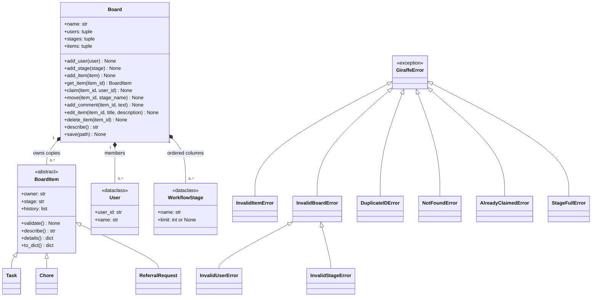

# Giraffe

Giraffe is a customizable board system for organizing software sprints, shared household chores, and referral requests. Members define workflow columns (stages), add and edit items, claim ownership, move items between columns, and comment on items. The board checks its rules before applying any change: **each item has at most one owner, and no column ever holds more items than its limit.**

For M1, Giraffe runs locally as plain Python objects with no networking. Tasks, chores and referral requests share one abstract interface. Boards save to and load from JSON, and `demo.py` runs the whole story from the command line. In M2 the boards move onto a server: clients connect over TCP and send requests, and only the server changes the boards.

- **Team:** 404NotFound (Ayush Jain, Bhuvana Kanakam, Prithvi Sunilkumar)
- **Course:** 95-895 Python Systems Fundamentals, Fall 2026, Mini 2
- **Milestone:** M2 Networked (builds on the M1 Domain Model)

## How to run

Requires Python 3.9 or newer. No packages to install.

```
cd giraffe
python demo.py
```

Choose a mode when prompted:

- **1. Interactive:** Choose **1** for the chores board or **2** for referrals. Then choose **1** to claim an item, **2** to move an item, or **3** to add a comment. Enter the requested item ID (such as `c1` or `r1`), user ID, destination stage, or comment. Available users and stages are printed when needed. Rule violations are displayed as rejected actions so you can keep trying.
- **2. Existing demo:** Run the prepared story described below.
- **0. Exit:** Close the program.

In interactive mode, **0** returns from the action menu to board selection, and **0** at board selection returns to mode selection. Changes remain available while switching boards in the same interactive session. Interactive changes are held in memory and are not saved to JSON; starting interactive mode again creates fresh sample boards. You can also exit with Ctrl+C or end-of-input.

For example, select mode `1`, board `1`, action `1`, item `c1`, and user `ayush` to claim the trash chore. Then select action `2`, item `c1`, and stage `In Progress` to move it.

In existing demo mode, `demo.py` builds a chores board and a referral board, claims and moves items, adds a comment, and shows two rejected operations caught as custom exceptions (`AlreadyClaimedError` for a double claim, `StageFullError` for a full "Accepted" column). It then saves each board to JSON (`chores_board.json`, `referral_board.json`), loads it back, and prints `loaded == original -> True`.

`python items.py` runs a smaller self-check of the item classes on their own.

### M2: server and client

Start the server in one terminal, then the client in another:

```
python server.py
python client.py
```

The client lists the server's boards, then lets you claim, move and comment, the same menu as `demo.py`'s interactive mode. Every action is a request to the server, and rejected actions print `Rejected: ...` so you can keep going. If the server is not running, too slow (5 seconds), or closes the connection, the client prints one clear `Error: ...` line and exits. Both accept `--host` and `--port` (default `127.0.0.1:5050`).

Run all tests with `python -m unittest discover tests`.

## Files

| File | What it holds | Detailed concept map |
|---|---|---|
| `items.py` | `User`, `WorkflowStage` (dataclasses), `BoardItem` (ABC), `Task`, `Chore`, `ReferralRequest`, `item_from_dict()` | [items.md](Files/Concept_Maps/items.md) |
| `errors.py` | The `GiraffeError` exception family | [errors.md](Files/Concept_Maps/errors.md) |
| `board.py` | `Board` (owns the state and enforces the rules), `save()`, `load_board()` | [board.md](Files/Concept_Maps/board.md) |
| `demo.py` | Mode selection, interactive board actions, and the runnable M1 story | [demo.md](Files/Concept_Maps/demo.md) |
| `protocol.py` | M2: message framing, the list of requests, reply format, all JSON for the network | [protocol.md](Files/Concept_Maps/protocol.md) |
| `server.py` | M2: owns the boards, answers requests, saves after every change | [M2 concept map](#m2-concept-map) |
| `client.py` | M2: the program a person runs to talk to the server | [client.md](Files/Concept_Maps/client.md) |
| `tests/test_client.py` | M2: 7 tests for the client and the safe save | [client.md](Files/Concept_Maps/client.md) |
| `data/` | M2: the server's board files, one JSON file per board | |
| `tests/test_protocol.py` | M2: 20 tests for the protocol and the history check | [protocol.md](Files/Concept_Maps/protocol.md) |

## Protocol (M2)

The server and client talk over **TCP sockets**. Every helper below is in `protocol.py`; neither `server.py` nor `client.py` calls `json` directly.

### Framing

- **One JSON object per line**, UTF-8, ending in `\n`. `json.dumps` writes a newline inside text as the two characters `\n`, so a real newline byte only ever means "end of message".
- **At most 64 KB per message.** A longer line is rejected without reading the rest.
- Default address `127.0.0.1:5050`. The client sends one request and waits for its reply before sending the next.

### Server state

- The server loads every `*.json` file in `data/` at startup with `load_board()`, so each board is checked by the same rules as in M1. Boards are found by their name.
- After a request that changes a board succeeds, the server saves that board back to its own file **before** replying. A change the client sees as successful is already on disk.
- Clients never read or write the files.
- **A save either fully replaces the board file or leaves the previous version untouched.** `Board.save()` writes to a temporary file and swaps it in with `os.replace`, so a crash mid-save can't leave a half-written board.

### Requests

Every request is `{"action": ..., <that action's fields>}` with no other fields.

| Action | Fields | Changes a board? | Server calls | `data` in a success reply |
|---|---|---|---|---|
| `list_boards` | none | No | List loaded board names | `["Apartment 4B Chores", "Amazon SDE Intern Referrals"]` |
| `get_board` | `board` | No | Look up the board by name | The whole board, in the same format as its save file |
| `claim` | `board`, `item_id`, `user_id` | Yes | `board.claim(item_id, user_id)` | The updated item |
| `move` | `board`, `item_id`, `stage` | Yes | `board.move(item_id, stage)` | The updated item |
| `add_comment` | `board`, `item_id`, `text` | Yes | `board.add_comment(item_id, text)` | The updated item |
| `add_item` | `board`, `item` | Yes | `board.add_item(item_from_dict(item))` | The new item |

All fields are text except `item`, which is an object in the same format as an item in a save file:

```json
{"action": "claim", "board": "Apartment 4B Chores", "item_id": "c1", "user_id": "ayush"}
{"action": "add_item", "board": "Apartment 4B Chores",
 "item": {"kind": "chore", "item_id": "c4", "title": "Vacuum", "due_date": "2026-11-25", "stage": "Unclaimed"}}
```

### Responses

```json
{"ok": true,  "data": {"kind": "chore", "item_id": "c1", "owner": "ayush", "stage": "Unclaimed", "...": "..."}}
{"ok": false, "error": "AlreadyClaimedError", "message": "Item 'c1' already belongs to 'prithvi'"}
```

`error` is the name of the exception that stopped the request, so the client can tell a full column from a double claim without reading the message.

### Errors

| `error` | When | After it |
|---|---|---|
| `ProtocolError` | Not JSON, not a JSON object, unknown action, or a missing, extra or wrong-type field, or reply exceeds the message size limit | Connection stays open |
| `FramingError` | Message over 64 KB, or the connection closed in the middle of one | Server replies, then closes that connection |
| `NotFoundError` | Unknown board, item, user or column | Connection stays open |
| `AlreadyClaimedError` | Claiming an item that already has an owner | Connection stays open |
| `StageFullError` | Moving or adding an item into a full column | Connection stays open |
| `DuplicateIDError` | `add_item` with an ID that is already used | Connection stays open |
| `InvalidItemError` | `add_item` with bad item data or an unknown `kind` | Connection stays open |
| `InvalidBoardError` | An empty comment, or the server could not save | Connection stays open |

Every error inherits from `GiraffeError`, so one bad request never stops the server.

## M2 concept map

Organized by the seven required M2 concepts (M2-R1 to M2-R7) in the project guide. The M1 concept map below still describes the domain classes, which M2 reuses unchanged.

| Concept | Where (file: lines) | Why it is needed here |
|---|---|---|
| M2-R1 · Client and server over TCP | client.py: 67-111; server.py: `GiraffeServer`, `RequestHandler` | The client opens one TCP connection with `socket.create_connection`, sends each request with `protocol.send_message`, and waits for the reply with `read_message` before sending the next. It never changes a board or reads the save files itself; the server does. |
| M2-R1 · Client menu as requests | client.py: 130-166, 176-197, 200-244 | The same menu as `demo.py`'s interactive mode, but board names come from `list_boards`, the board from `get_board`, and claim / move / comment are requests. `MENU_ACTIONS` maps each menu number to a function, so there is no if/elif on the choice. |
| M2-R7 · Client only knows the protocol | client.py: 32, 37-43, 130-145 | Like the lecture's `reg_client.py`, the client never imports `board.py`, `items.py` or `errors.py`. It prints items straight from their JSON, showing each kind's own fields generically, so a new item kind needs no client change. `ServerConnectionError` is a `ConnectionError`, not a domain error. |
| M2-R2 · Server owns the state, loads at startup | `server.py`: `BoardStore.__init__` | Loads each JSON file from `data/` and records its path by board name. |
| M2-R2 · Save after every successful change | `server.py`: `BoardStore.handle_request` | Applies the domain operation to a copy, saves it to disk, then publishes it and returns success. |
| M2-R2 · A crash during save keeps the old file | board.py: 305-320 | `save()` writes to `path + ".tmp"`, then swaps it in with `os.replace`, which happens in one step. A crash mid-write only breaks the temp file, so the server never restarts from a half-written board. If writing fails, the temp file is deleted and `InvalidBoardError` is raised. |
| M2-R2 · Loaded state is checked, bad history rejected | items.py: 152-156, 180-192 | The server loads its boards from JSON at startup, so a damaged file must not load quietly. A saved `"history": "oops"` used to become `['o', 'o', 'p', 's']`; `from_dict()` now checks the type before the constructor copies it, and `_check_common()` checks every entry is text, so `load_board()` raises `InvalidItemError`. A missing or unknown item field also becomes `InvalidItemError` instead of a `TypeError`, so a bad `add_item` request can't crash the server. |
| M2-R3 · Message framing: one JSON object per line | protocol.py: 31-38, 145-150, 166-188 | TCP is a stream of bytes with no boundaries, so every message ends in `\n`. `json.dumps` writes newlines inside text as `\n`, so a real newline only ever ends a message. `read_message()` returns `None` when the other side closes cleanly. |
| M2-R3 · Message size limit | protocol.py: 35, 148-149, 181-185 | Without a limit, one client sending a line with no newline could make the server read forever. `readline(limit)` stops at 64 KB. |
| M2-R4 · Documented protocol | README.md: "Protocol (M2)"; protocol.py: 67-74 | `REQUEST_FIELDS` lists every action and its fields in code, and the README tables are written from it, so the documentation matches what the server accepts. |
| M2-R4 · Requests checked against the table | protocol.py: 82-108 | `validate_request()` rejects an unknown action or a missing, extra or wrong-type field before the board is touched. It looks the action up in a dict instead of an if/elif chain, like `ITEM_KINDS`, so a new request is one line. |
| M2-R5 · All network JSON in one place | protocol.py: 119-124, 127-138, 145-163 | `encode` / `decode`, `ok_response` / `error_response` and `board_to_dict` are the only places Python objects become JSON for the network. Server and client never call `json`. |
| M2-R5 · Replies use the save file's format | protocol.py: 127-138 | `board_to_dict()` gives the same shape as `Board.save()`, built only from Board's read-only properties, so a reply can never change the board. |
| M2-R6 · Bad requests become error replies | protocol.py: 41-48, 123-124, 153-163 | `ProtocolError` inherits from `GiraffeError`, so the server answers a malformed request and a broken rule with the same `except GiraffeError`. Broken JSON or the wrong shape never crashes the reader. |
| M2-R6 · Knowing when to drop a connection | protocol.py: 51-57, 183-187 | After an oversized or cut-off line, the next message's start can't be found, so `FramingError` tells the server to reply and close that one connection. |
| M2-R6 · Server keeps running after bad requests | `server.py`: `RequestHandler.serve_requests` | Returns a JSON error and continues reading after a bad request. A framing error ends only the current connection. |
| M2-R6 · Client survives a refused or dropped connection | client.py: 37-43, 67-111, 269-276 | Every socket problem becomes a `ServerConnectionError` with a clear message: server not running (`ConnectionRefusedError`), too slow (`socket.timeout`, 5 seconds), or closed (`read_message` returns `None`, or a reset / cut-off reply). `main()` prints one line and exits instead of showing a traceback. After a timeout the connection is closed, because a late reply would be read as the answer to the next request. |
| M2-R6 · Rejections are normal replies | client.py: 161-166 | A broken rule comes back as `{"ok": false, ...}`, so the client prints `Rejected: ...` and the user keeps going. Only lost connections raise. |
| M2-R7 · Networking separate from the domain | protocol.py: whole file; board.py, items.py, errors.py unchanged except the history check | Socket and JSON code lives in `protocol.py`, `server.py` and `client.py`. The M1 classes are reused as they are, and the board rules stay in `Board`. |
| Optional · Tests for the protocol | tests/test_protocol.py: 38-214 | 20 tests: framing edge cases, every request and rejection, both reply shapes, the history check, and a real round trip over a TCP socket. Run `python -m unittest discover tests`. |
| Optional · Tests for the client and safe save | tests/test_client.py: 45-174 | 7 tests: a save and load leaves no temp file, a failed save keeps the old file and deletes the temp file, and the client against fake servers that answer, reject, are not running, are too slow, or hang up, plus a check that the client imports no domain module. |
| Optional · `--host` / `--port` flags | client.py: 256-260; server.py: `main` | The server flags set the address to listen on. The client flags set the address to connect to. Both use the same defaults from `protocol.py`. |
| Optional · Logging every request | `server.py`: `RequestHandler.serve_requests` | Logs the client address, action, and outcome for every request. |

## M1 concept map

Organized by the six required M1 concepts (R1 to R6) in the project guide, followed by optional depth. Each per-file map linked above has the same rows plus code snippets, which files use it, and check-in talking points.

### R1. Classes and data classes

| Concept | Where (file: lines) | Why it is needed here |
|---|---|---|
| Data classes | items.py: 35-50 (`WorkflowStage`), 53-64 (`User`) | A column is just a name and an optional limit, and a user is just an ID and a name. They hold facts with no rules, so `@dataclass` writes `__init__`, `__repr__` and `__eq__` for us. `frozen=True` stops anyone from quietly raising a column's limit after the board checked it. |
| Regular classes for things with rules | items.py: 74-290; board.py: 25-281 | Items validate themselves and control how their owner and column change, and a board enforces rules across many objects at once, so these are regular classes with methods. |

### R2. Abstract base class and polymorphism

| Concept | Where (file: lines) | Why it is needed here |
|---|---|---|
| Abstract base class | items.py: 74-201 (abstract methods 132-142) | Every item must validate itself, describe itself and list its own fields for saving. `BoardItem(ABC)` declares `validate()`, `describe()` and `details()` with `@abstractmethod`, so Python refuses to create a plain `BoardItem` or a subclass that forgets one. |
| Concrete subclasses | items.py: 210-231 (`Task`), 234-259 (`Chore`), 262-290 (`ReferralRequest`) | A task, a chore and a referral request each *is a* board item, and every parent method (owner, column, history) makes sense for all three. `super().__init__` (lines 216, 240, 272) reuses the shared setup. Each validates differently: points, a real due date, a company and applicant. |
| Used through the base class, no type checks | board.py: 101, 216, 298; demo.py: 121-123; items.py: 328-330 | `Board` calls `item.validate()`, `item.describe()` and `item.to_dict()` on any item and never checks whether it holds a Task, Chore or ReferralRequest, so adding a new kind needs no change to `Board`. |
| No if/elif on kind when loading | items.py: 299-312 | `ITEM_KINDS` maps each saved kind to its class and `item_from_dict()` looks it up, so adding a kind is one new dictionary line. |

### R3. Composition

| Concept | Where (file: lines) | Why it is needed here |
|---|---|---|
| Board owns the collections | board.py: 30-36 | `Board` owns the members (`_users`), columns (`_stages`) and items (`_items`). It is the single owner of the state that M2 moves onto the server and M3 protects with a lock. |
| One owner class, many board types | demo.py: 30-49, 52-73 | The chores board and the referral board are both `Board` objects with different members, columns and limits, which shows the design is configurable. |

### R4. Encapsulated state changes and custom exceptions

| Concept | Where (file: lines) | Why it is needed here |
|---|---|---|
| Invariant: one owner per item | board.py: 132-151 | `claim()` checks the item exists, the user is a member and the item is unclaimed (line 146) before calling `set_owner()` (line 151). A second claim raises `AlreadyClaimedError` and changes nothing. |
| Invariant: column limits | board.py: 118-127 (`add_item`), 153-182 (`move`) | Both methods count the items already in the target column and raise `StageFullError` before anything changes. This is what keeps the 2-slot "Accepted" column at 2. |
| Validated setup | board.py: 61-94 | `add_user()` and `add_stage()` reject empty IDs, negative limits and duplicates, so a board can't start in a broken state. |
| Other changes go through methods | board.py: 184-194, 220-227, 229-264 | Comments, deletes and edits each have one method that validates every input first and only then changes the item. |
| Item state changes only through methods | items.py: 98-127 | `owner`, `stage` and `history` are read-only properties. Only `set_owner()` and `set_stage()` change them, `Board` calls those after its checks pass, and each change is logged to the item's history. |
| Defensive copies | board.py: 51-53, 55-59, 100; items.py: 93, 106-109 | Items are copied into and out of `Board`, and history is copied into and out of each item, so outside code can never change board-owned state without going through a method. |
| Custom exception family | errors.py: 15-40; demo.py: 158 | Each way Giraffe refuses an operation has its own class, so callers can tell "full" from "already claimed" by name. All inherit from `GiraffeError`, so one `except GiraffeError` catches any rule violation. Interactive mode uses this on demo.py line 158, and the M2 server will use it to send error responses. |
| Raise before changing anything | items.py: 146-156, 219-224, 244-252, 276-283; board.py: 146-151, 177-182 | Every check runs before the single line that changes state, so a rejected operation leaves the board exactly as it was. `demo.py` prints the state after each rejection to prove it. |

### R5. File persistence

| Concept | Where (file: lines) | Why it is needed here |
|---|---|---|
| Save to JSON | board.py: 287-320; items.py: 45-46, 59-60, 161-173 | Each object writes its own dict. Items always include `"kind"` because JSON has no idea which class an object came from. Columns are saved as a list so the workflow order survives. The full JSON text is built (line 303) before the file is opened, so a failure can't leave a half-written file. |
| Load through the public methods | board.py: 330-373 (rebuild on 359-367) | `load_board()` rebuilds the board with `add_user`, `add_stage` and `add_item`, so loaded data passes the same rule checks as new data. A hand-edited file with three items in a 2-slot column raises `StageFullError` instead of loading. |
| Rebuild the right subclass | items.py: 175-192, 299-312 | `item_from_dict()` picks the class from `"kind"` and `from_dict()` builds it, so a saved chore comes back as a `Chore`. An unknown kind raises `InvalidItemError`. |
| Bad files raise custom errors | board.py: 316-320, 338-355, 368-371 | A missing file, broken JSON or a wrong shape raises `InvalidBoardError` instead of a raw `OSError` or `KeyError`, and `from e` keeps the original cause for debugging. |

### R6. Runnable demo and README

| Concept | Where (file: lines) | Why it is needed here |
|---|---|---|
| Normal operations | demo.py: 81-85, 99-103 | Claims, moves and a comment all go through `Board` methods, never by changing an item directly. |
| Rejected operation 1: double claim | demo.py: 88-93 | Raises `AlreadyClaimedError`, caught by name and printed, then the owner is printed to show nothing changed. |
| Rejected operation 2: full column | demo.py: 106-111 | Raises `StageFullError`, caught by name and printed, then the item's column is printed to show it stayed put. |
| Save and load round trip | demo.py: 114-119 | `loaded == original -> True` for both boards, using `Board.__eq__`, proves nothing was lost, including column order and item history. |
| Interactive mode (Ayush) | demo.py: 126-159 | Lets the user claim, move and comment on either sample board. `except GiraffeError` (line 158) catches every custom error through the shared base class, so any broken rule is printed as "Rejected" and the user can keep trying. |
| Run instructions | README.md: "How to run"; demo.py: 162-185 | `python demo.py` opens mode selection; choose 1 for interactive actions or 2 for the full story. The main guard means it only runs when started directly, not when imported. |

### Optional depth

| Concept | Where (file: lines) | Why it is needed here |
|---|---|---|
| Properties | items.py: 98-113; board.py: 38-53 | Read-only access is what stops `item.owner = "x"` from skipping the one-owner rule. Board's properties return tuples of frozen dataclasses and copies of items, so reading state can't change it. |
| Dunder methods | items.py: 194-201; board.py: 265-281 | `__repr__` gives readable output while debugging. `__eq__` on items and on `Board` (members, column order, every item and its history) is how we prove a save and load round trip loses nothing. |
| Type hints | Throughout all four files | Every method states what it takes and returns, which makes the contracts between `items.py`, `board.py` and `demo.py` clear. |
| Class diagram | README.md: "Class diagram" | Shows the composition (`Board` owns users, columns and items) and the inheritance (`BoardItem` and its three kinds) at a glance. |

## Class diagram



## Who built what

| Part | Built by | AI assistance |
|---|---|---|
| `items.py`: `User`, `WorkflowStage`, `BoardItem` ABC, `Task`, `Chore`, `ReferralRequest`, `item_from_dict` | Bhuvana Kanakam | Claude helped structure the file and its concept map |
| `errors.py`: the `GiraffeError` exception family | Ayush Jain | None in the code; ChatGPT helped with the concept map |
| `board.py`: `Board` rules (add, claim, move, comment, edit, delete, describe, `__repr__`, `__eq__`) | Ayush Jain | None in the code; ChatGPT helped with the concept map |
| `board.py`: `Board.save()` and `load_board()` | Prithvi Sunilkumar | Claude helped draft the code and concept map |
| `demo.py`: scripted story (`run_demo`) | Prithvi Sunilkumar | Claude helped draft the code and concept map |
| `demo.py`: interactive mode and mode menu (`run_interactive`, `main`) | Ayush Jain | ChatGPT helped with the code |
| Repo setup, README, concept map consistency | Bhuvana Kanakam | Claude helped align the maps with the project guide |
| M2 `protocol.py`, `tests/test_protocol.py`, README protocol section, history check in `items.py` | Bhuvana Kanakam | Claude helped structure the code, tests and documentation |
| M2 `server.py` | Ayush Jain | ChatGPT helped draft the server and test request handling |
| M2 `client.py`, `tests/test_client.py`, safe save in `board.py` | Prithvi Sunilkumar | Claude helped draft the code, tests and concept map |
| Concept maps | Each person wrote the map for their own code | As listed above |

## AI use

- **items.py and items.md (Bhuvana):** Claude helped structure the file and write the concept map. Reviewed, tested and explainable by the author.
- **errors.py and board.py rules (Ayush):** No AI in the code. ChatGPT helped prepare the concept maps from the source.
- **demo.py interactive mode and mode menu (Ayush):** ChatGPT helped with the code. Reviewed, tested and explainable by the author.
- **board.py save/load, demo.py and demo.md (Prithvi):** Claude helped draft the code and documentation. Reviewed, run end to end, and explainable by the author.
- **M2 server.py (Ayush):** ChatGPT helped draft the server and test request handling.
- **M2 client.py, tests/test_client.py, safe save and client.md (Prithvi):** Claude helped draft the code, the tests and the documentation. Reviewed, run against a test server, and explainable by the author.
- **M2 protocol.py, tests, README protocol section and the history check (Bhuvana):** Claude helped structure the code, the tests and the documentation. Reviewed, tested and explainable by the author.
- **README and concept map consistency (Bhuvana):** Claude helped align all four concept maps and this README with the project guide's required concepts and checked every line reference against the code.

## Web UI (extra, not part of M1)

Live at https://giraffe-boards.netlify.app/ (source: `docs/index.html`).

An optional browser front end built on top of the M1 design. It re-implements the same rules from `board.py`, `items.py` and `errors.py` in JavaScript and can export and import the same JSON that `Board.save()` and `load_board()` use. It is not connected to the Python code and is not one of the M1 concepts graded above. AI use: built with Claude (Anthropic) and reviewed by Bhuvana Kanakam.
