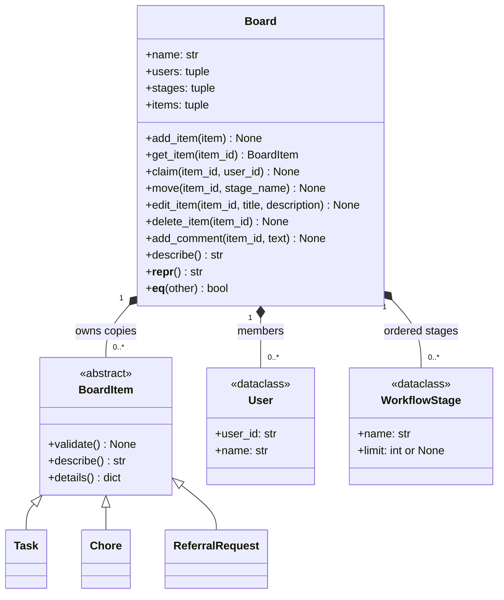

# Giraffe

Giraffe is a customizable board system for organizing software sprints, shared household chores, and referral requests. Members can define workflow stages, add and edit items, claim ownership, move items between stages, and add comments to an item's activity history. The board checks ownership and stage-capacity rules before applying changes.

For M1, Giraffe runs locally as plain Python objects with no networking. Tasks, chores, and referral requests share a common interface, alongside users and configurable workflow stages. Boards save to and load from JSON files, and `demo.py` runs the whole story from the command line. A shared server comes in M2.

**Team:** 404NotFound (Ayush Jain, Bhuvana Kanakam, Prithvi Sunilkumar)
**Course:** 95-895 Python Systems Fundamentals, Fall 2026
**Folder started by:** Bhuvana Kanakam (bkanakam)

## How to run

Requires Python 3.9 or newer. No packages to install.

```
cd giraffe
python demo.py
```

`demo.py` builds a chores board and a referral board, claims and moves items, adds a comment, and shows two rejected actions caught as custom exceptions (`AlreadyClaimedError` for a double claim, `StageFullError` for a full "Accepted" stage). It then saves each board to JSON (`chores_board.json`, `referral_board.json`), loads it back, and prints `loaded == original -> True`. Running `python items.py` on its own runs a smaller self-check of the item classes.

Each code file has its own concept map here, written by the person who built that file. Each map lists every course concept in the file, the exact lines, and why we used it there. The combined table in the main README is built from these.

| File | Concept map | Owner | Status |
|---|---|---|---|
| items.py | [items.md](Files/Concept_Maps/items.md) | Bhuvana Kanakam | Done |
| errors.py | [errors.md](Files/Concept_Maps/errors.md) | Ayush Jain |  Done |
| board.py (rules) | [board.md](Files/Concept_Maps/board.md) | Ayush Jain | Done |
| board.py (save and load) | [board.md](Files/Concept_Maps/board.md) | Prithvi Sunilkumar | Done |
| demo.py | [demo.md](Files/Concept_Maps/demo.md) | Prithvi Sunilkumar | Done |

## Format for each file

1. Header: author, milestone, file
2. Summary table: Concept | File: lines | Why it is needed here
3. Each concept in detail, with a short code snippet
4. Which other files use this one
5. Check-in talking points

## Before submitting

- Line numbers change whenever a file is edited. Recheck every row after the final merge.
- Copy the summary rows into the concept map in the main README, since graders score against that one.
- Every "why" should say why the concept fits *our* project, not just what the concept is. That is the difference between scoring Correct (2) and Justified (3).

## Class diagram



Board properties support inspection without exposing mutable board-owned items. Its repr shows a compact summary; equality compares domain state, including stage order and item history. Board methods have parameter and return type hints. The existing item model also provides properties, repr, equality, and type annotations.

## Concept map

Combined from the per-file maps in [Files/Concept_Maps/](Files/Concept_Maps/). Each per-file map has details, code snippets, which files use it, and check-in talking points.

| Concept | File: lines | Why it is needed here |
|---|---|---|
| Dataclass | items.py: 35-50 (`WorkflowStage`), 53-64 (`User`) | Stages and users are plain facts with no rules, so a dataclass gives us `__init__`, `__repr__` and `__eq__` without writing them. `frozen=True` stops them from being changed after creation. |
| Abstract base class | items.py: 74-184 | Every item on a board must be able to validate itself, describe itself, and list its own fields for saving. `BoardItem` forces that, and Python refuses to create a plain `BoardItem`. |
| Abstract methods | items.py: 132-142 | `validate()`, `describe()` and `details()` are different for every kind, so the base class only declares them and each subclass must write its own. |
| Inheritance and `super()` | items.py: 193-214, 217-242, 245-273 (`super()` on 199, 223, 255) | A task, a chore and a referral request each *is a* board item, so inheritance is the right fit. `super().__init__` reuses the shared setup (id, title, owner, stage, history) instead of copying it three times. |
| Polymorphism | items.py: 311-313; used by Board in `add_item()` | The same two calls, `item.validate()` and `item.describe()`, run on any kind of item. No code checks the type, so Board works with all three kinds and any we add later. |
| Encapsulation with `@property` | items.py: 98-113 | `owner`, `stage` and `history` are read-only from outside. Code can read `item.owner` but can't write `item.owner = "x"`, so nothing can skip Board's one-owner rule. |
| Controlled state changes | items.py: 118-127 | `set_owner()` and `set_stage()` are the only way to change an item's owner or stage. Board calls them after its checks pass, and each change is logged to the item's history. |
| Defensive copy | items.py: 93, 106-109 | `history` is copied on the way in and on the way out, so a list from outside can't change the item's real history. |
| Custom exception | items.py: 146-151, 202-207, 227-235, 259-266 | Bad item data raises `InvalidItemError` (defined in `errors.py`) with a message that says exactly what is wrong, instead of failing silently or printing. |
| JSON save | items.py: 156-168 (`to_dict`), 45-50 and 59-64 (dataclasses) | Each item saves its shared fields plus its own `details()`, and always includes `"kind"` so we know which class to rebuild later. |
| JSON load with no if/elif | items.py: 282-295 | `ITEM_KINDS` maps each saved kind to its class. `item_from_dict()` looks the class up and builds it. Adding a new kind is one new line in the dict. |
| Dunder methods | items.py: 177-184 (`__repr__`, `__eq__`) | `__repr__` gives a readable printout while debugging. `__eq__` lets us check that an item saved and loaded back is the same as the original. |
| Type hints | throughout | Every method says what it takes and returns, which makes the contract with `board.py` clear. |
| Self-check | items.py: 302-324 | Running `python items.py` shows polymorphism, a save/load round trip, and a rejected item without needing the rest of the project. |
| Custom exceptions | errors.py: 15–40| Gives callers specific reasons why Giraffe rejects invalid data or board operations. |
| Inheritance | errors.py: 15–40 | All domain errors inherit from GiraffeError, allowing the demo to catch expected Giraffe failures together. |
| Docstrings | Throughout | Explains which rule or failure each exception represents. |
| Composition | board.py: 30-36 | Board owns members, stages, and items as the future shared state. |
| Read-only properties | board.py: 39-40; board.py: 43-44; board.py: 47-48 | The name is read-only; user and stage collections are tuples containing frozen dataclasses. |
| Defensive copies and ownership | board.py: 96-130; board.py: 51-53; board.py: 55-59 | Copy on admission and copy on retrieval prevent external references from changing board-owned items, including nested history. |
| Validated admission | board.py: 61-75; board.py: 77-94; board.py: 96-130 | Validate data, uniqueness, membership, and capacity before inserting. |
| Polymorphism | board.py: 96-130; board.py: 196-218 | Call validate() and describe() through BoardItem without branching on concrete subclass. |
| Ownership invariant | board.py: 132-151 | Reject a second claim before updating owner or history. |
| Capacity invariant | board.py: 153-182 | Count destination items before moving; same-stage moves change nothing. |
| Validate before mutation | board.py: 184-194; board.py: 229-264 | Check all supplied fields before changing text or history. |
| Collection removal | board.py: 220-227 | Reject missing IDs; removal frees stage capacity. |
| Read-only presentation | board.py: 196-218 | Return a grouped text summary without changing state. |
| Custom exceptions and type hints | Throughout | Explain domain rejections and document operation contracts. |
| JSON save (Prithvi) | board.py: 287-309 | `save()` writes the name, users, stages and items to JSON. Stages go in a list so the workflow order survives, and each item's `to_dict()` includes its `"kind"` so the right class can be rebuilt. |
| Load through public methods (Prithvi) | board.py: 319-362 (rebuild on 348-356) | `load_board()` rebuilds the board with `add_user`, `add_stage` and `add_item`, so every rule runs again on loaded data and nothing outside Board touches `_items`. Stages load before items because `add_item` checks the stage exists. |
| No if/elif on kind when loading (Prithvi) | board.py: 356 | Each item goes through `item_from_dict()`, which uses the `ITEM_KINDS` lookup, so load works for any kind without type checks. |
| Custom exceptions for bad files (Prithvi) | board.py: 305-309, 327-346, 357-360 | A missing file, broken JSON or the wrong shape raises `InvalidBoardError` instead of a raw `OSError`/`KeyError`/`TypeError`, so callers only need to catch Giraffe errors. `raise ... from e` keeps the original cause for debugging. |
| Fail before writing (Prithvi) | board.py: 303 | The JSON text is built in full before the file is opened, so a serialization error can't leave a half-written file. |
| One class, many board types | demo.py: 30-49, 52-73 | The chores board and the referral board are both plain `Board` objects with different users, stages and items. This shows Giraffe is configurable instead of hard-coding one workflow. |
| Dataclasses as configuration | demo.py: 34-41, 56-62 | Users and stages are created as frozen `User` and `WorkflowStage` dataclasses and handed to the board. |
| Stage limit as a rule | demo.py: 60 | "Accepted" has `limit=2` because the company gives two referral slots. Board enforces this, not the demo. |
| Changes go through Board's methods | demo.py: 81-85, 99-103 | Every claim, move and comment goes through a Board method that checks the rules first. The demo never touches an item's owner or stage directly. |
| Custom exception caught and printed: double claim | demo.py: 88-93 | Claiming an item that already has an owner raises `AlreadyClaimedError`. The demo catches it by name, prints why, and shows the owner didn't change. |
| Custom exception caught and printed: full stage | demo.py: 106-111 | Moving a third request into a 2-slot "Accepted" stage raises `StageFullError`. The demo shows the item stayed where it was, proving Board raises before it changes anything. |
| JSON save and load | demo.py: 114-120 | Each board is saved with `board.save()` and rebuilt with `load_board()`. `loaded == original` uses `Board.__eq__` to prove nothing was lost, including stage order and item history. |
| Polymorphism | demo.py: 122-123 | The same `item.describe()` call prints every loaded item. The loop never checks whether an item is a `Chore` or a `ReferralRequest`. |
| Read-only snapshots | demo.py: 93, 111, 122 | `get_item()` and `items` return copies, so the demo can read state without being able to change the board. |
| Main guard | demo.py: 126-127 | The story only runs when the file is run directly, not when it is imported. |

## Who built what

| Part | Built by |
|---|---|
| `items.py`: `User`, `WorkflowStage`, `BoardItem` ABC, `Task`, `Chore`, `ReferralRequest`, `item_from_dict` | Bhuvana Kanakam |
| `errors.py`: the `GiraffeError` exception family | Ayush Jain |
| `board.py`: `Board` rules (add, claim, move, comment, edit, delete, describe, `__repr__`, `__eq__`) | Ayush Jain |
| `board.py`: `Board.save()` and `load_board()` | Prithvi Sunilkumar |
| `demo.py` | Prithvi Sunilkumar |
| README and concept maps | Each person wrote the map for their own code; Bhuvana set up the README, Prithvi added how to run and the combined table |

## AI use

- **items.py and items.md (Bhuvana):** Claude helped structure the file and write the concept map. Reviewed, tested and explainable by the author.
- **errors.py and board.py rules (Ayush):** No AI in the code. ChatGPT helped prepare the concept maps from the source.
- **board.py save/load, demo.py, demo.md, and the README run instructions and combined table (Prithvi):** Claude (Anthropic) helped draft the code and documentation. Reviewed, run end to end, and explainable by the author.
