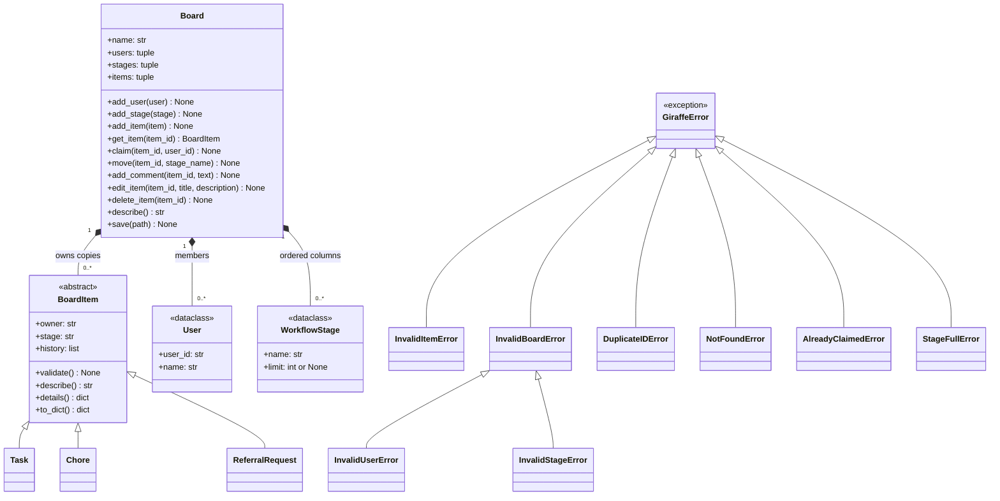

# Giraffe

Giraffe is a customizable board system for organizing software sprints, shared household chores, and referral requests. Members define workflow columns (stages), add and edit items, claim ownership, move items between columns, and comment on items. The board checks its rules before applying any change: **each item has at most one owner, and no column ever holds more items than its limit.**

For M1, Giraffe runs locally as plain Python objects with no networking. Tasks, chores and referral requests share one abstract interface. Boards save to and load from JSON, and `demo.py` runs the whole story from the command line. In M2 the `Board` object becomes the server's shared state.

- **Team:** 404NotFound (Ayush Jain, Bhuvana Kanakam, Prithvi Sunilkumar)
- **Course:** 95-895 Python Systems Fundamentals, Fall 2026, Mini 2
- **Milestone:** M1 Domain Model

## How to run

Requires Python 3.9 or newer. No packages to install.

```
cd giraffe
python demo.py
```

Choose a mode when prompted:

- **1. Interactive:** Choose **1** for the chores board or **2** for referrals. Then choose **1** to claim an item, **2** to move an item, or **3** to add a comment. Enter the requested item ID (such as `c1` or `r1`), user ID, destination stage, or comment. Available users and stages are printed when needed. Rule violations are displayed as rejected actions so you can keep trying.
- **2. Existing demo:** Run the prepared story described below.
- **0. Exit:** Close the program.

In interactive mode, **0** returns from the action menu to board selection, and **0** at board selection returns to mode selection. Changes remain available while switching boards in the same interactive session. Interactive changes are held in memory and are not saved to JSON; starting interactive mode again creates fresh sample boards. You can also exit with Ctrl+C or end-of-input.

For example, select mode `1`, board `1`, action `1`, item `c1`, and user `ayush` to claim the trash chore. Then select action `2`, item `c1`, and stage `In Progress` to move it.

In existing demo mode, `demo.py` builds a chores board and a referral board, claims and moves items, adds a comment, and shows two rejected operations caught as custom exceptions (`AlreadyClaimedError` for a double claim, `StageFullError` for a full "Accepted" column). It then saves each board to JSON (`chores_board.json`, `referral_board.json`), loads it back, and prints `loaded == original -> True`.

`python items.py` runs a smaller self-check of the item classes on their own.

## Files

| File | What it holds | Detailed concept map |
|---|---|---|
| `items.py` | `User`, `WorkflowStage` (dataclasses), `BoardItem` (ABC), `Task`, `Chore`, `ReferralRequest`, `item_from_dict()` | [items.md](Files/Concept_Maps/items.md) |
| `errors.py` | The `GiraffeError` exception family | [errors.md](Files/Concept_Maps/errors.md) |
| `board.py` | `Board` (owns the state and enforces the rules), `save()`, `load_board()` | [board.md](Files/Concept_Maps/board.md) |
| `demo.py` | Mode selection, interactive board actions, and the runnable M1 story | [demo.md](Files/Concept_Maps/demo.md) |

## Concept map

Organized by the six required M1 concepts (R1 to R6) in the project guide, followed by optional depth. Each per-file map linked above has the same rows plus code snippets, which files use it, and check-in talking points.

### R1. Classes and data classes

| Concept | Where (file: lines) | Why it is needed here |
|---|---|---|
| Data classes | items.py: 35-50 (`WorkflowStage`), 53-64 (`User`) | A column is just a name and an optional limit, and a user is just an ID and a name. They hold facts with no rules, so `@dataclass` writes `__init__`, `__repr__` and `__eq__` for us. `frozen=True` stops anyone from quietly raising a column's limit after the board checked it. |
| Regular classes for things with rules | items.py: 74-273; board.py: 25-281 | Items validate themselves and control how their owner and column change, and a board enforces rules across many objects at once, so these are regular classes with methods. |

### R2. Abstract base class and polymorphism

| Concept | Where (file: lines) | Why it is needed here |
|---|---|---|
| Abstract base class | items.py: 74-184 (abstract methods 132-142) | Every item must validate itself, describe itself and list its own fields for saving. `BoardItem(ABC)` declares `validate()`, `describe()` and `details()` with `@abstractmethod`, so Python refuses to create a plain `BoardItem` or a subclass that forgets one. |
| Concrete subclasses | items.py: 193-214 (`Task`), 217-242 (`Chore`), 245-273 (`ReferralRequest`) | A task, a chore and a referral request each *is a* board item, and every parent method (owner, column, history) makes sense for all three. `super().__init__` (lines 199, 223, 255) reuses the shared setup. Each validates differently: points, a real due date, a company and applicant. |
| Used through the base class, no type checks | board.py: 101, 216, 298; demo.py: 121-123; items.py: 311-313 | `Board` calls `item.validate()`, `item.describe()` and `item.to_dict()` on any item and never checks whether it holds a Task, Chore or ReferralRequest, so adding a new kind needs no change to `Board`. |
| No if/elif on kind when loading | items.py: 282-295 | `ITEM_KINDS` maps each saved kind to its class and `item_from_dict()` looks it up, so adding a kind is one new dictionary line. |

### R3. Composition

| Concept | Where (file: lines) | Why it is needed here |
|---|---|---|
| Board owns the collections | board.py: 30-36 | `Board` owns the members (`_users`), columns (`_stages`) and items (`_items`). It is the single owner of the state that M2 moves onto the server and M3 protects with a lock. |
| One owner class, many board types | demo.py: 30-49, 52-73 | The chores board and the referral board are both `Board` objects with different members, columns and limits, which shows the design is configurable. |

### R4. Encapsulated state changes and custom exceptions

| Concept | Where (file: lines) | Why it is needed here |
|---|---|---|
| Invariant: one owner per item | board.py: 132-151 | `claim()` checks the item exists, the user is a member and the item is unclaimed (line 146) before calling `set_owner()` (line 151). A second claim raises `AlreadyClaimedError` and changes nothing. |
| Invariant: column limits | board.py: 118-127 (`add_item`), 153-182 (`move`) | Both methods count the items already in the target column and raise `StageFullError` before anything changes. This is what keeps the 2-slot "Accepted" column at 2. |
| Validated setup | board.py: 61-94 | `add_user()` and `add_stage()` reject empty IDs, negative limits and duplicates, so a board can't start in a broken state. |
| Other changes go through methods | board.py: 184-194, 220-227, 229-264 | Comments, deletes and edits each have one method that validates every input first and only then changes the item. |
| Item state changes only through methods | items.py: 98-127 | `owner`, `stage` and `history` are read-only properties. Only `set_owner()` and `set_stage()` change them, `Board` calls those after its checks pass, and each change is logged to the item's history. |
| Defensive copies | board.py: 51-53, 55-59, 100; items.py: 93, 106-109 | Items are copied into and out of `Board`, and history is copied into and out of each item, so outside code can never change board-owned state without going through a method. |
| Custom exception family | errors.py: 15-40 | Each way Giraffe refuses an operation has its own class, so callers can tell "full" from "already claimed" by name. All inherit from `GiraffeError`, so one `except GiraffeError` catches any rule violation, which the M2 server will use to send error responses. |
| Raise before changing anything | items.py: 146-151, 202-207, 227-235, 259-266; board.py: 146-151, 177-182 | Every check runs before the single line that changes state, so a rejected operation leaves the board exactly as it was. `demo.py` prints the state after each rejection to prove it. |

### R5. File persistence

| Concept | Where (file: lines) | Why it is needed here |
|---|---|---|
| Save to JSON | board.py: 287-309; items.py: 45-46, 59-60, 156-168 | Each object writes its own dict. Items always include `"kind"` because JSON has no idea which class an object came from. Columns are saved as a list so the workflow order survives. The full JSON text is built (line 303) before the file is opened, so a failure can't leave a half-written file. |
| Load through the public methods | board.py: 319-362 (rebuild on 348-356) | `load_board()` rebuilds the board with `add_user`, `add_stage` and `add_item`, so loaded data passes the same rule checks as new data. A hand-edited file with three items in a 2-slot column raises `StageFullError` instead of loading. |
| Rebuild the right subclass | items.py: 170-175, 282-295 | `item_from_dict()` picks the class from `"kind"` and `from_dict()` builds it, so a saved chore comes back as a `Chore`. An unknown kind raises `InvalidItemError`. |
| Bad files raise custom errors | board.py: 305-309, 327-344, 357-360 | A missing file, broken JSON or a wrong shape raises `InvalidBoardError` instead of a raw `OSError` or `KeyError`, and `from e` keeps the original cause for debugging. |

### R6. Runnable demo and README

| Concept | Where (file: lines) | Why it is needed here |
|---|---|---|
| Normal operations | demo.py: 81-85, 99-103 | Claims, moves and a comment all go through `Board` methods, never by changing an item directly. |
| Rejected operation 1: double claim | demo.py: 88-93 | Raises `AlreadyClaimedError`, caught by name and printed, then the owner is printed to show nothing changed. |
| Rejected operation 2: full column | demo.py: 106-111 | Raises `StageFullError`, caught by name and printed, then the item's column is printed to show it stayed put. |
| Save and load round trip | demo.py: 114-119 | `loaded == original -> True` for both boards, using `Board.__eq__`, proves nothing was lost, including column order and item history. |
| Run instructions | README.md: "How to run"; demo.py: 126-127 | `python demo.py` opens mode selection; choose 1 for interactive actions or 2 for the full story. The main guard means it only runs when started directly, not when imported. |

### Optional depth

| Concept | Where (file: lines) | Why it is needed here |
|---|---|---|
| Properties | items.py: 98-113; board.py: 38-53 | Read-only access is what stops `item.owner = "x"` from skipping the one-owner rule. Board's properties return tuples of frozen dataclasses and copies of items, so reading state can't change it. |
| Dunder methods | items.py: 177-184; board.py: 265-281 | `__repr__` gives readable output while debugging. `__eq__` on items and on `Board` (members, column order, every item and its history) is how we prove a save and load round trip loses nothing. |
| Type hints | Throughout all four files | Every method states what it takes and returns, which makes the contracts between `items.py`, `board.py` and `demo.py` clear. |
| Class diagram | README.md: "Class diagram" | Shows the composition (`Board` owns users, columns and items) and the inheritance (`BoardItem` and its three kinds) at a glance. |

## Class diagram



## Who built what

| Part | Built by | AI assistance |
|---|---|---|
| `items.py`: `User`, `WorkflowStage`, `BoardItem` ABC, `Task`, `Chore`, `ReferralRequest`, `item_from_dict` | Bhuvana Kanakam | Claude helped structure the file and its concept map |
| `errors.py`: the `GiraffeError` exception family | Ayush Jain | None in the code; ChatGPT helped with the concept map |
| `board.py`: `Board` rules (add, claim, move, comment, edit, delete, describe, `__repr__`, `__eq__`) | Ayush Jain | None in the code; ChatGPT helped with the concept map |
| `board.py`: `Board.save()` and `load_board()` | Prithvi Sunilkumar | Claude helped draft the code and concept map |
| `demo.py` | Prithvi Sunilkumar | Claude helped draft the code and concept map |
| Repo setup, README, concept map consistency | Bhuvana Kanakam | Claude helped align the maps with the project guide |
| Concept maps | Each person wrote the map for their own code | As listed above |

## AI use

- **items.py and items.md (Bhuvana):** Claude helped structure the file and write the concept map. Reviewed, tested and explainable by the author.
- **errors.py and board.py rules (Ayush):** No AI in the code. ChatGPT helped prepare the concept maps from the source.
- **board.py save/load, demo.py and demo.md (Prithvi):** Claude helped draft the code and documentation. Reviewed, run end to end, and explainable by the author.
- **README and concept map consistency (Bhuvana):** Claude helped align all four concept maps and this README with the project guide's required concepts and checked every line reference against the code.

## Web UI (extra, not part of M1)

Live at https://giraffe-boards.netlify.app/ (source: `docs/index.html`).

An optional browser front end built on top of the M1 design. It re-implements the same rules from `board.py`, `items.py` and `errors.py` in JavaScript and can export and import the same JSON that `Board.save()` and `load_board()` use. It is not connected to the Python code and is not one of the M1 concepts graded above. AI use: built with Claude (Anthropic) and reviewed by Bhuvana Kanakam.
