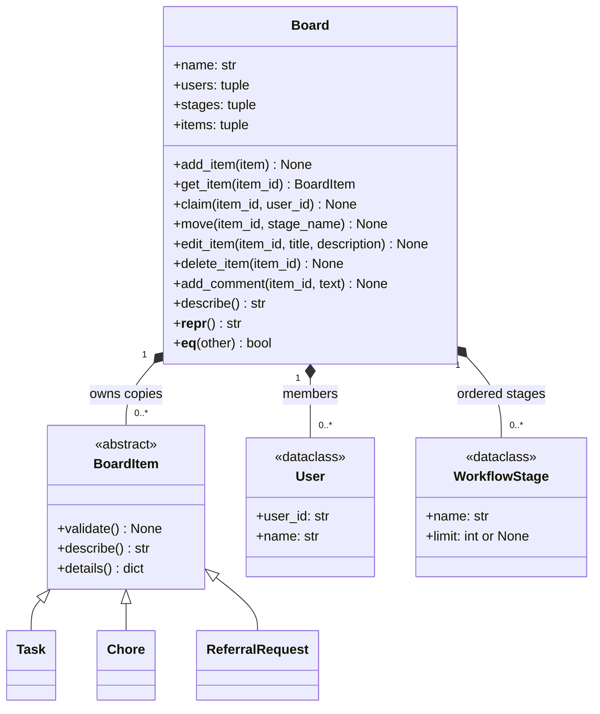

# Giraffe

Giraffe is a customizable board system for organizing software sprints, shared household chores, and referral requests. Members can define workflow stages, add and edit items, claim ownership, move items between stages, and add comments to an item's activity history. The board checks ownership and stage-capacity rules before applying changes.

For M1, Giraffe runs locally as plain Python objects with no networking. Tasks, chores, and referral requests share a common interface, alongside users and configurable workflow stages. JSON file persistence and an integrated command-line demo are planned parts of this milestone; a shared server comes in M2.

**Team:** 404NotFound (Ayush Jain, Bhuvana Kanakam, Prithvi Sunilkumar)
**Course:** 95-895 Python Systems Fundamentals, Fall 2026
**Folder started by:** Bhuvana Kanakam (bkanakam)

Each code file has its own concept map here, written by the person who built that file. Each map lists every course concept in the file, the exact lines, and why we used it there. The combined table in the main README is built from these.

| File | Concept map | Owner | Status |
|---|---|---|---|
| items.py | [items.md](Files/Concept_Maps/items.md) | Bhuvana Kanakam | Done |
| errors.py | [errors.md](Files/Concept_Maps/errors.md) | Ayush Jain |  Done |
| board.py (rules) | [board.md](Files/Concept_Maps/board.md) | Ayush Jain | Done |
| board.py (save and load) | [board.md](Files/Concept_Maps/board.md) | Prithvi Sunilkumar | To do |
| demo.py | demo.md | Prithvi Sunilkumar | To do |

## Format for each file

1. Header: author, milestone, file
2. Summary table: Concept | File: lines | Why it is needed here
3. Each concept in detail, with a short code snippet
4. Which other files use this one
5. Check-in talking points

## Before submitting

- Line numbers change whenever a file is edited. Recheck every row after the final merge.
- Copy the summary rows into the concept map in the main README, since graders score against that one.
- Every "why" should say why the concept fits *our* project, not just what the concept is. That is the difference between scoring Correct (2) and Justified (3).

## Class diagram

Board properties support inspection without exposing mutable board-owned items. Its repr shows a compact summary; equality compares domain state, including stage order and item history. Board methods have parameter and return type hints. The existing item model also provides properties, repr, equality, and type annotations.
